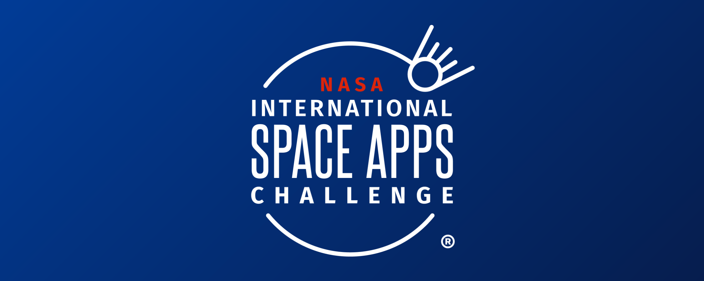

<p align="center">
  
</p>

<h1 align="center">Astro FIT</h1>

<p align="center">
  <b>Autonomous Deep-Space Astronaut Health &amp; Clinical Decision-Support Console</b>
</p>

<p align="center">
  <a href="https://astro-fit-ten.vercel.app/"></a>
  
  
  
  
  
</p>

<p align="center">
  <i>Offline-capable PWA for monitoring astronaut physiology, forecasting threshold breaches, guiding self-exams, and prescribing countermeasures — even through 20-minute one-way delays and solar conjunction blackouts.</i>
</p>

---

## Project Links

| Resource | Description | Link |
| --- | --- | --- |
| **Live Deployment** | Production build hosted on Vercel | https://astro-fit-ten.vercel.app/ |
| **Presentation Slides** | Pitch deck walkthrough | `[ADD_SLIDES_LINK_HERE]` |
| **Video Demo** | Full feature walkthrough on YouTube | `[ADD_YOUTUBE_VIDEO_LINK_HERE]` |

---

## About Astro FIT

**Astro FIT** is an offline-capable Progressive Web App (PWA) and aerospace biomedical telemetry cockpit built for astronauts operating on long-duration orbital, lunar, and Mars transit missions. Aligned with NASA's **Human Research Program (HRP) 5 Hazards of Human Spaceflight**, Astro FIT monitors physiological biomarkers in real time, forecasts upcoming threshold violations, guides onboard self-exams, and prescribes autonomous countermeasures — even during up to 20-minute Earth communication delays or solar conjunction blackouts.

As crewed exploration moves from Low Earth Orbit (ISS) to the Moon (Artemis) and Mars, real-time ground flight-surgeon support becomes impossible due to deep-space speed-of-light latency (up to ~20+ minutes one-way) and periodic solar conjunction communication blackouts.

Astro FIT puts an autonomous, flight-deck clinical decision-support system directly on the crew's tablet, console, or mobile device. It combines a deterministic biomedical rule engine, a clinical anatomical CAD schematic, oscilloscope-grade 14-day + 5-day predictive telemetry charts, a 15-second cognitive reflex test (NASA PVT-B), ultrasound diagnostic intake, and an onboard Flight Surgeon Co-Pilot.

### Why Is It Useful?

- **Zero-Wait Deep-Space Autonomy** — Operates 100% locally offline via Service Worker caching and IndexedDB queuing when Earth DSN links drop or latency exceeds 18+ minutes.
- **Early Trajectory Intervention** — Instead of reacting only after a medical emergency occurs, linear regression trajectory forecasting alerts crew members *days* before cumulative radiation, resting heart rate, or sleep deprivation cross NASA clinical limits.
- **Actionable Self-Exams & Countermeasures** — Translates raw physiological drift into plain-language physiological explanations, step-by-step ultrasound/self-exam protocols, and NASA-aligned countermeasures (e.g., ARED resistive loading, circadian light therapy, radiation shelter entry, LBNP fluid-shift mitigation).
- **Sustained Crew Compliance** — Gamified Mission Readiness scoring (0–100%), daily health streaks, and countermeasure execution checklists reinforce preventive daily habits across 180+ day confinement missions.

---

## How It Works

### 1. Deterministic NASA HRP Clinical Rule Engine — `src/lib/hrpEngine.ts`

- **4 Calibrated Mission Environments** — Switch seamlessly between **ISS Orbital Station** (0g, TDRS real-time), **Mars Deep-Space Transit** (0g, 18m 42s one-way delay, autonomous mode), **Lunar Surface Base** (0.16g, 1.3s direct), and **Pressurized Rover** (0.16g, EVA mobility).
- **9 Monitored Biomarkers** — Heart Rate (bpm), Systolic & Diastolic Blood Pressure (mmHg), Blood Glucose (mg/dL), Body Temperature (°C), Sleep Duration (hrs), Cumulative Radiation Dose (mSv), Bone Density Index (T-score), and Behavioral Mood/Cognitive Score (/10).
- **4 Body Systems** — Evaluates **Neuro & Behavioral** (SANS / Psychomotor), **Cardiovascular**, **Musculoskeletal**, and **Radiation & Immune** into ISO/aerospace status tiers (`● NOMINAL`, `▲ CAUTION`, `✖ CRITICAL`). Completing daily routine tasks and countermeasures dynamically mitigates active CAUTION states and boosts Mission Readiness.
- **4 Built-In 14-Day Mission Scenarios** — Instant switch between *Nominal ISS Orbit*, *Mars Transit — Solar Particle Event (SPE)*, *Lunar EVA — Cardiovascular Strain & Mild Dehydration*, and *Day 180 Confinement — Behavioral Fatigue & Bone Density Dip*.

### 2. Precision CAD Anatomical Schematic — `src/components/AnatomicalBodyMap.tsx`

- Interactive medical CAD wireframe displaying clickable **SYS-01** through **SYS-04** system callouts (CRANIAL, THORAX, AXIAL, DOSIMETRY).
- Clicking any anatomical region or callout opens the **Clinical Inspection & Self-Exam Drawer** with calibrated baselines, NASA 5 Hazards physiological rationale, hardware checklists, and step-by-step self-exam instructions.

### 3. Oscilloscope Telemetry & +5-Day Predictive Threshold Alerts — `src/components/DynamicTelemetryCharts.tsx`

- Renders 14-day historical trends and a **+5-day linear least-squares trajectory forecast** across Cardiovascular (HR & Sys BP), Cumulative Dosimetry (mSv vs. mission limit), and Circadian Sleep & Cognitive traces.
- Automatically flags projected CAUTION and CRITICAL limit breaches with breach day estimates and clickable inspection links.

### 4. Multi-Modal Self-Check Logger — `src/components/SelfCheckModal.tsx`

- **Vitals & Biomarkers** — Manual slider calibration for all physiological inputs.
- **15-Second Cognitive Reaction Test (NASA PVT-B)** — Interactive Psychomotor Vigilance Task measuring mean reaction latency (ms) and false starts to compute a cognitive fatigue score (/10).
- **Diagnostic Scan & Ultrasound Selector** — Supports local image upload and diagnostic presets (e.g., Ocular Optic Nerve Sheath Ultrasound for SANS, Calcaneal QUS Bone Scan, Thoracic Cardiac & IVC Filling Ultrasound) that immediately update body map statuses.

### 5. Offline-First PWA & Deep-Space Blackout Sync — `src/lib/offlineSync.ts`

- Persists snapshots and queued vital logs in browser **IndexedDB**.
- Includes a **Simulate Blackout** toggle inside the DSN Sync modal to test conjunction-blackout queuing, JSON telemetry export, and automatic/manual resynchronization once the Earth link restores.

### 6. Autonomous Flight Surgeon Co-Pilot — `src/components/FlightSurgeonAssistant.tsx` + `server.ts`

- Live-telemetry-aware clinical assistant backed by **Google Gemini** (`@google/genai`) on the Express backend (`POST /api/flight-surgeon/chat`), injecting active environment, biomarkers, system statuses, and prioritized countermeasures.
- Automatically switches to an onboard offline NASA HRP knowledge base (`generateLocalFlightSurgeonReply`) whenever network connectivity is lost or during simulated blackouts.

---

## NASA Data & Research Usage

This application is directly grounded in public scientific and clinical frameworks published by the **NASA Human Research Program (HRP)**:

| Source | How it is used in Astro FIT |
| --- | --- |
| **NASA HRP: 5 Hazards of Human Spaceflight** | The core risk-evaluation engine (`src/lib/hrpEngine.ts`), hazard exposure matrix, and interactive anatomical CAD body map are mapped directly onto NASA's 5 Hazards (Space Radiation, Isolation & Confinement, Distance from Earth, Gravity Fields, and Hostile Closed Environments). Every biomarker and body system links back to the specific spaceflight hazards driving its risk profile. |
| **NASA HRP: Risks of Human Spaceflight** | Used to define clinical thresholds (NOMINAL, CAUTION, CRITICAL), physiological rationale, and targeted countermeasures for microgravity fluid shifts, cardiovascular deconditioning, bone mineral density (T-score) loss, cumulative radiation dose limits (mSv), SANS optic nerve distension, and circadian/behavioral fatigue — including protocols such as ARED resistive exercise, circadian light therapy, isotonic hydration, and radiation storm sheltering. |
| **NASA HRP: Ongoing HRP Research in Space** | Informed the design of long-duration Mars transit and lunar surface crew self-assessment workflows, including the 15-second Psychomotor Vigilance Task (PVT-B) cognitive reaction module, ultrasound self-exam protocols (ocular optic nerve sheath and cardiac/IVC filling checks), and autonomous clinical monitoring under Earth communication delays. |

---

## Tech Stack

| Layer | Technologies |
| --- | --- |
| **Frontend** | React 19, TypeScript, Tailwind CSS v4, Lucide Icons, custom responsive SVG oscilloscope & CAD graphics |
| **Backend** | Node.js, Express (`server.ts`), `@google/genai` SDK |
| **Offline & PWA** | `vite-plugin-pwa` (Workbox precaching & offline fallback), browser IndexedDB telemetry queue & snapshot persistence |
| **Build Tooling** | Vite 8, `tsx` |

---

## Project Structure

```text
├── public/
│   ├── Space_apps.png                      # README banner asset
│   ├── icon.svg / pwa-*.png                # PWA icons & manifest assets
├── src/
│   ├── components/
│   │   ├── AnatomicalBodyMap.tsx           # Interactive clinical CAD wireframe
│   │   ├── AutonomousCountermeasurePanel.tsx # Crew posture, 5-Hazards matrix & queue
│   │   ├── BiomarkerControlPanel.tsx       # 9-channel sensor sliders & self-log form
│   │   ├── ClinicalInspectionDrawer.tsx    # System details & self-exam protocols
│   │   ├── CrewReadinessHUD.tsx            # Readiness score, streak & daily checklist
│   │   ├── DynamicTelemetryCharts.tsx      # 14d + 5d oscilloscope plots & alerts
│   │   ├── FlightSurgeonAssistant.tsx      # AI & offline Flight Surgeon drawer
│   │   ├── OfflineSyncModal.tsx            # IndexedDB queue & blackout simulator
│   │   ├── PWAInstallButton.tsx            # Install prompt & iOS Safari guide
│   │   └── SelfCheckModal.tsx              # Vitals, 15s PVT-B & ultrasound logger
│   ├── hooks/usePWAInstall.ts              # Cross-platform PWA install hook
│   ├── lib/
│   │   ├── hrpEngine.ts                    # NASA HRP evaluator, presets & forecast
│   │   └── offlineSync.ts                  # IndexedDB storage & sync manager
│   ├── App.tsx                             # Responsive flight-deck cockpit workspace
│   ├── index.css                           # Matte aerospace theme & touch controls
│   └── main.tsx                            # App bootstrap & Service Worker registration
├── server.ts                               # Express + Vite SPA & Gemini API
├── .env.example                            # Environment variable template
└── package.json
```

---

## Getting Started

### Prerequisites

- **Node.js** >= 20 (tested on Node v22+)
- **npm** >= 10

### Installation & Local Development

**1. Install dependencies**

```bash
npm install
```

**2. Configure environment variables**

Copy `.env.example` to `.env` and add your Gemini API key.

> Optional — without an API key, the Flight Surgeon automatically operates using the onboard offline NASA HRP clinical knowledge base.

```env
GEMINI_API_KEY="your_gemini_api_key"
APP_URL="http://localhost:3000"
```

**3. Run the development server** (port 3000)

```bash
npm run dev
```

**4. Type-check, build, and run in production**

```bash
npm run lint
npm run build
npm start
```

### Environment Variables

| Variable | Required | Description |
| --- | --- | --- |
| `GEMINI_API_KEY` | No | Google Gemini API key for the Flight Surgeon Co-Pilot. Falls back to the offline knowledge base when absent. |
| `APP_URL` | No | Public base URL of the app. Defaults to `http://localhost:3000`. |
| `PORT` | No | Backend port. Defaults to `3000`. |

### Available Scripts

| Script | Command | Purpose |
| --- | --- | --- |
| `npm run dev` | `tsx server.ts` | Start the Express + Vite dev server on port 3000 |
| `npm run build` | `vite build` | Production build into `dist/` |
| `npm start` | `node server.ts` | Serve the production build |
| `npm run lint` | `tsc --noEmit` | TypeScript type-check |
| `npm run preview` | `vite preview` | Preview the production build |
| `npm run clean` | `rm -rf dist server.js` | Remove build artifacts |

---

## Deployment

The live demo is deployed on **Vercel**: [astro-fit-ten.vercel.app](https://astro-fit-ten.vercel.app/)

When deploying, set `GEMINI_API_KEY` in your hosting provider's environment variables to enable the live AI Flight Surgeon. Without it, the app remains fully functional using its offline clinical knowledge base.

---

## Disclaimer

Astro FIT is a **hackathon prototype** built for the NASA International Space Apps Challenge. It is an educational and demonstrative tool and is **not** a certified medical device. It must not be used for actual clinical diagnosis or real spaceflight medical operations.

---

<p align="center">
  <sub>Built with ❤️ for the NASA International Space Apps Challenge</sub>
</p>
